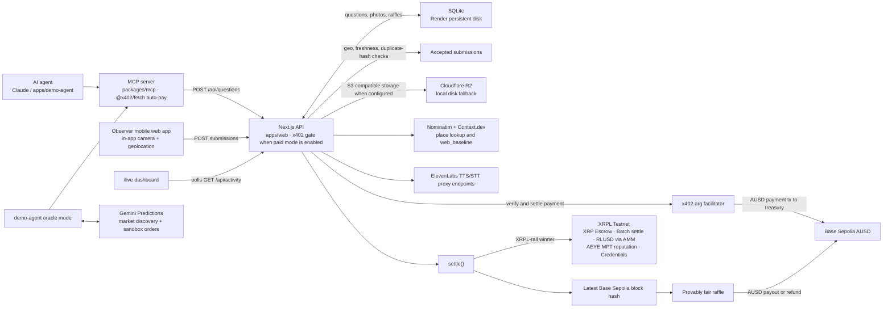

# A-eye

A-eye lets an AI agent ask a question about a real place. Nearby people answer with a fresh, geolocated photo; the agent receives the tally, evidence gallery, and a verifiable raffle result. See [PLAN.md](PLAN.md) for the project plan.

## Layout

- `apps/web`: Next.js 16 app, HTTP API, observer experience, and live dashboard.
- `packages/mcp`: stdio MCP server used by agents.
- `packages/shared`: shared request schemas and API types.
- `apps/demo-agent`: standalone ask and Gemini Predictions oracle demos.
- `apps/web/lib/store.ts`: SQLite schema, question/submission operations, settlement, and raffle.
- `scripts/xrpl-*.ts` and `apps/web/lib/xrpl.ts`: the optional XRPL Testnet rail (escrow, Batch settlement, RLUSD, MPT reputation, credentials).

## Develop

Requires Node.js 22.13 or newer for the built-in `node:sqlite`.

```bash
npx -y npm@11 install
npm run dev
npm run typecheck && npm test && npm run build
```

The web app is available at `http://localhost:3000`. SQLite defaults to `apps/web/.data/a-eye.db`; photos use `apps/web/.data/uploads` unless an S3-compatible store is configured. Reset the local database and its demo seed with `npm run db:reset -w @a-eye/web`.

Camera and geolocation require HTTPS on a phone. Use an HTTPS tunnel or the hosted demo. For local S3-compatible storage, MinIO can be started with Docker; set `S3_BUCKET`, `S3_ENDPOINT`, and the matching AWS-compatible credentials before running the app.

## Pages and API

- `/`: nearby open questions.
- `/q/[id]/answer`: answer a question with the in-app camera and location check.
- `/q/[id]`: results, evidence gallery, comparisons, and raffle details.
- `/live`: live event feed and dashboard; polls `GET /api/activity?since=&limit=`.
- `/agents`: agent setup information and a test-question form.
- `/me`: observer identity, payout wallet, entries, winnings, stats and badges.
- `/leaderboard`: observer rankings for the week or all time.
- `GET /api/questions`: open questions; `POST /api/questions`: create a question.
- `POST /api/questions/[id]/submissions`: submit a photo answer.
- `GET /api/questions/[id]`: question results.
- `GET /api/activity?since=<ISO>&limit=<n>`: counters, open questions, and recent activity events.

The activity feed settles questions whose deadline has passed when polled. Questions also close immediately when they reach `max_responses`.

## MCP

Install dependencies and build the stdio server:

```bash
npx -y npm@11 install && npm run build -w @a-eye/mcp
npx @modelcontextprotocol/inspector -e A_EYE_API_URL=http://localhost:3000 node packages/mcp/dist/index.js
```

For configuration, `args` must be the absolute path to `packages/mcp/dist/index.js`. The same `mcpServers` JSON works for Claude Desktop (`claude_desktop_config.json`), Claude Code (`.mcp.json` in the project), and Cursor (`.cursor/mcp.json` or `~/.cursor/mcp.json`):

```json
{
  "mcpServers": {
    "a-eye": {
      "command": "node",
      "args": ["/path/to/A-eye/packages/mcp/dist/index.js"],
      "env": { "A_EYE_API_URL": "https://a-eye-1zsv.onrender.com" }
    }
  }
}
```

Tools include `ask_location_question`, `get_question_results` (with photos as image blocks), `peek_results` (paid interim results), `wait_for_results`, `check_coverage`, and `list_my_questions`. Each evidence item carries `observer_reputation` — the observer's agreement rate with the crowd on past closed questions plus their answer count — so agents can weight answers.

Option strings must be distinct, and `prize_usd` must be from 0.01 to 500. Without a wallet, questions are stored under `A_EYE_AGENT_LABEL` (default `mcp-agent`); on an unpaid server, set a unique label or `list_my_questions` shows every unpaid MCP agent's questions. Paying agents are identified by their wallet address. `A_EYE_MCP_MAX_IMAGES` caps attached evidence images (default 8), and `wait_for_results` accepts `timeout_s` from 0 to 1800 seconds.

### Payments: x402 and AUSD on Base Sepolia

When a treasury is configured and unpaid mode is disabled, `POST /api/questions` uses [x402](https://x402.org) v2. It requests an exact payment in AUSD on `eip155:84532`, with the amount derived from `prize_usd`. The x402 facilitator verifies and settles the payment to the treasury; the question records the payer and payment transaction. Treasury payouts and refunds use the facilitator by default, so the treasury does not need Base Sepolia ETH for gas. Set `A_EYE_PAYOUT_RAIL=direct` to try direct transfers instead; if facilitator settlement fails, the service also falls back to a direct transfer, which does require treasury ETH. At settlement, the treasury pays the raffle winner 90% of the gross pot, or refunds a paid question that expires without enough answers. `ALLOW_UNPAID_QUESTIONS=1` bypasses question and peek payment challenges.

While a question is open and paywalling is active, the free results API and gallery hide the tally and evidence to prevent herding. Agents can call `GET /api/questions/:id/peek` or the MCP `peek_results` tool to pay for interim results. `A_EYE_PEEK_PRICE_USD` sets the AUSD price (default `$0.02`; set it to `0` to disable the paywall). Paid peek fees add to the gross raffle pot, and the winner receives 90% of the prize plus peek revenue, rounded to cents. Final results are free after close. If a question expires, only its original prize is refunded; peek fees remain with the treasury.

Optional `webhook_url` on `POST /api/questions` receives one POST of the final results JSON when the question settles or expires. Destinations must resolve only to public HTTP(S) addresses. `A_EYE_SETTLE_SWEEP_MS` sets the background expiry sweep interval in milliseconds (default `30000`; set to `0` to disable), and `A_EYE_PUBLIC_URL` supplies the public origin used for result links when no request origin was stored.

The MCP server can pay automatically when `AGENT_PRIVATE_KEY` or `A_EYE_AGENT_PRIVATE_KEY` is set. It signs an ERC-3009 authorization, retries the request with the x402 payment header, and returns the facilitator transaction as `payment_tx`. `A_EYE_MAX_PAYMENT_USD` caps an agent payment (default 25). Without a wallet, a paid question request fails with a payment error.

```json
"env": {
  "A_EYE_API_URL": "https://a-eye-1zsv.onrender.com",
  "AGENT_PRIVATE_KEY": "0x..."
}
```

For testnet wallet funding and balances, run `npx tsx scripts/fund-wallets.mts`. A live x402 integration test is available with `X402_E2E=1` in `apps/web/lib/x402.e2e.test.ts`; it requires funded test wallets and treasury configuration.

## Demo agent

The demo agent uses the A-eye MCP server for questions and results. Its LLM needs `OPENAI_API_KEY` or `DEEPSEEK_API_KEY`; set `A_EYE_API_URL` to choose the server. Examples:

```bash
npm run ask -w @a-eye/demo-agent -- "Is there a line at the coffee cart outside Chou Hall?" --minutes 10
npm run oracle -w @a-eye/demo-agent -- --minutes 10 --dry-run
```

Oracle discovery reads Gemini sandbox and production markets, but order placement is hard-coded to the sandbox. Remove `--dry-run` only when Gemini sandbox credentials are configured and a sandbox order is intended. `npm run oracle -w @a-eye/demo-agent -- --list` lists observable contracts.

### Push notifications

Observers can opt in to "new question near you" web push (installable PWA + `/sw.js`). Generate VAPID keys once with `npm run vapid:keys` and set `VAPID_PUBLIC_KEY` / `VAPID_PRIVATE_KEY` / `VAPID_SUBJECT` on Render — with none set, push is a silent no-op. Subscriptions are stored server-side with a coarse (~110 m) location, and one subscription hears about at most one question every 3 minutes (`PUSH_MIN_INTERVAL_SECONDS`).

## XRPL: escrowed pots, RLUSD payouts, on-ledger reputation (Testnet)

Observers who pick **RLUSD (XRP Ledger)** on `/me` are paid on the XRP Ledger Testnet. The XRPL rail combines five ledger features into one flow: the agent's prize is committed up front, the winner is paid in a dollar stablecoin, the platform fee is taken in the same atomic step, and the observer's track record lives on the ledger, not in our database.

### Primitive map

| Step in the A-eye flow | XRPL primitive | What it does |
| :-- | :-- | :-- |
| Agent posts a paid question | **Escrow** (`EscrowCreate`, XRP) | Locks the gross prize (quoted from the XRP/RLUSD AMM plus a 10% buffer) with `FinishAfter`/`CancelAfter`, so the pot is publicly committed before anyone answers. |
| Raffle picks an XRPL-rail winner | **Batch** (XLS-56, `tfAllOrNothing`) | A single transaction runs `EscrowFinish`, the winner payout, and the platform-fee `Payment`. Either all three succeed or none does. |
| Winner payout | **RLUSD** + **AMM** cross-currency `Payment` | `Amount` = RLUSD IOU (net prize), `SendMax` = released XRP minus the fee. The ledger converts XRP to RLUSD through the XRP/RLUSD AMM in the same payment. Winners with no RLUSD trust line receive XRP instead. |
| Question expires unanswered | **Escrow** (`EscrowCancel`) | Refunds the pot to the treasury. |
| Observer onboarding on `/me` | **Batch** (`TrustSet` + `MPTokenAuthorize`) | Signed in the browser with a local test wallet. One atomic transaction adds the RLUSD trust line and opts in to the reputation token. |
| Each accepted answer | **Multi-Purpose Token** `AEYE` ("A-eye Verified Answers") | Asset scale 0, non-transferable, XLS-89 metadata. The issuer mints 1 AEYE per accepted answer, grouped into `tfIndependent` Batches, so the observer's reputation is portable and verifiable on-ledger. |
| After N accepted answers | **Credentials** (`CredentialCreate` / `CredentialAccept`) | Issuer grants the "A-eye Verified Observer" credential, and the observer accepts it from `/me`. |

**Why XRP escrow + AMM instead of RLUSD TokenEscrow:** `TokenEscrow` is enabled on Testnet, but the RLUSD Testnet issuer (`rQhWct2fv4Vc4KRjRgMrxa8xPN9Zx9iLKV`) does not set `asfAllowTrustLineLocking`, so RLUSD cannot be escrowed. We keep the commitment in XRP and deliver RLUSD at settlement through the AMM, all inside the same Batch, so the winner still receives dollars atomically.

**Fallback:** if Batch fails (a `tem*`/`temDISABLED` result, a submit error, or any inner result other than `tesSUCCESS`), settlement falls back to sequential `EscrowFinish` → payout (RLUSD via the AMM, or XRP) → fee `Payment`. Each step is persisted, so retries are idempotent. Results show `settle_mode` (`batch` or `sequential`) and an explorer link for each transaction.

Amendments checked live on Testnet (`feature` RPC): `BatchV1_1`, `fixBatchV1_2`, `TokenEscrow`, `fixTokenEscrowV1`, `MPTokensV1`, `Credentials` are all enabled.

### Run the Testnet demo

```sh
npm run xrpl:setup -- --role treasury   # faucet wallet + RLUSD trust line + RLUSD liquidity; writes .env.xrpl.local (gitignored)
npm run xrpl:setup -- --role issuer     # credential + reputation-token issuer
npm run xrpl:setup -- --role observer   # a test observer wallet
npm run xrpl:demo                       # onboarding Batch → escrow → settlement Batch → AEYE mint → credential
```

The demo prints every transaction hash, including each inner Batch transaction, with a `testnet.xrpl.org` link. It never prints seeds. To enable the rail in the app, set `XRPL_TREASURY_SEED` and `XRPL_ISSUER_SEED`. Optional variables: `XRPL_FEE_ADDRESS` (defaults to the issuer), `XRPL_REP_MPT_ID` (reuse an existing AEYE issuance), and `XRPL_XRP_PER_USD` (fixed rate instead of the AMM quote).

### Explorer proof (Testnet)

Live run of `npm run xrpl:demo` on 2026-10-11. Every transaction below is validated `tesSUCCESS`. The settlement Batch and its three inner transactions are all in ledger 21463486.

| Step | Transaction |
| :-- | :-- |
| AEYE reputation MPT issuance | [`014781A9…9AFA`](https://testnet.xrpl.org/mpt/014781A9938471C652D0E54540BF792FC0E72163C0389AFA) |
| Observer onboarding Batch (`TrustSet` + `MPTokenAuthorize`) | [`1EE0680F…746D`](https://testnet.xrpl.org/transactions/1EE0680FFFF4BFB3C6DF74D54DEAC711945BE390319A324B0C9966A9E501746D) |
| Pot escrow, 3.904394 XRP gross (`EscrowCreate`) | [`B43663E8…6A79`](https://testnet.xrpl.org/transactions/B43663E81BA899A46F18736787E551550A13B58F8DD75A4DC12DE445C3B26A79) |
| **Settlement Batch** (`tfAllOrNothing`) | [`3FF5ECC8…C228`](https://testnet.xrpl.org/transactions/3FF5ECC8955A2A1344A8BC4F4BDE93C7B5EE7DE1C00EED40D685AD2BB346C228) |
| ↳ inner `EscrowFinish` | [`0EE93565…D8AE`](https://testnet.xrpl.org/transactions/0EE93565DB15AE79A83500BDDD0EF246887A711C49FDCD648025865DB4A9D8AE) |
| ↳ inner payout: 0.9 RLUSD delivered via the AMM (`SendMax` 3.513955 XRP) | [`B36DD939…91C8F`](https://testnet.xrpl.org/transactions/B36DD9391BE3EEE8AADB20BBDA375DF4BE1FC86DB65C761A81A4836695691C8F) |
| ↳ inner platform fee, 0.390439 XRP | [`3BBBCDB7…EE53`](https://testnet.xrpl.org/transactions/3BBBCDB7A7AF6BC569C6E6FB26FF4607A7A810E9DA9AA28DE30CC36BC16CEE53) |
| 3 AEYE reputation points minted | [`416EAF8D…07A6`](https://testnet.xrpl.org/transactions/416EAF8D578DC93B92AC4CAE9B1578D7D43C0769E17D5D5F179EB27E7F5F07A6) |
| Verified Observer `CredentialCreate` / `CredentialAccept` | [`651724D8…12D0`](https://testnet.xrpl.org/transactions/651724D83351EC2F097649BFAE0655C1865BC0DFA5DC9B14A11C7265D10F12D0) / [`AC4CEAF2…CDAE`](https://testnet.xrpl.org/transactions/AC4CEAF27D0ECFE0938BB04E6EAF6F1EC108445B47C9806E846717321B68CDAE) |

At the end of the run the observer holds 0.9 RLUSD and 3 AEYE.

### Developer feedback

- **XRPL docs MCP (`mcp.xrpledger.ai`, from the dev portal's `.mcp.json`):** this was the most useful tool. Its semantic search returned exactly the right chunk on the first try for two questions that decided our design: the XLS-85 `asfAllowTrustLineLocking` flag (which ruled out RLUSD TokenEscrow), and the Batch tutorial's warning that an outer `tesSUCCESS` "does not guarantee the inner transactions succeeded". One rough edge: it accepts only MCP protocol `2025-11-25` and rejects older clients with `-32600 Unsupported protocol version`, so some MCP clients can't connect yet.
- **Context7 (`/xrplf/xrpl-dev-portal`):** good snippets when it worked (single-account Batch with `tfInnerBatchTxn`, `mpt_holders`), but our MCP calls hit "Monthly quota exceeded" partway through. Without an API key it's unreliable during a hackathon.
- **`xrpl.org/mcp`:** a "code mode" server (`describe-tools` + `execute` JS sandbox). It's powerful, but it adds a round trip compared with plain search tools.
- **SKILL.md (`xrpl-payments`, `xrpl-trading`, `xrpl-agent-wallet`):** accurate where it has coverage. It lists the right RLUSD Testnet issuer, says to set up the trust line first (`tecNO_LINE`), covers cross-currency `SendMax`, and says to read `meta.delivered_amount`. We followed those patterns directly. Gap: none of the three skills or their references mention Batch, MPTs/`MPTokenAuthorize`, TokenEscrow, or Credentials, which were four of our five primitives, and escrow is documented as XRP-only. A `xrpl-batch`/`xrpl-tokens` skill would have saved most of our spike time.
- **What we had to learn by experiment:** (1) xrpl.js `autofill` fills inner Batch `Fee: "0"`/`SigningPubKey: ""`/`Sequence` but does not set `tfInnerBatchTxn`, so you add it yourself. The validation error says so clearly. (2) Finding inner results: compute each inner hash with `hashes.hashSignedTx(RawTransaction)` and look it up with `tx`. In our spike, an independent Batch returned outer `tesSUCCESS` with one inner `tecNO_AUTH` (mint to a holder that hadn't opted in). (3) An XRP→RLUSD `Payment` with `SendMax` and no `Paths` routes through the AMM by default. (4) `MPTokenIssuanceCreate` validation `console.warn`s about XLS-89 metadata (`icon`, `asset_class`, `issuer_name`). `encodeMPTokenMetadata` with every field keeps logs quiet.
- **What worked well:** Testnet faucet + 3–5 s validation made a full escrow → Batch settlement → MPT mint loop runnable in under a minute, and the AMM's depth (~220k RLUSD) meant no order-book setup for payouts.

## Deploy

The Render service is [`https://a-eye-1zsv.onrender.com`](https://a-eye-1zsv.onrender.com) (configuration in `render.yaml`). It runs as one Node server and mounts a persistent disk at `/var/data` for SQLite and local uploads. Render currently sets `ALLOW_UNPAID_QUESTIONS=1`; configure a treasury and disable that flag to demonstrate x402 payments. Configure the `S3_*` environment variables to store photos in Cloudflare R2 instead of on the Render disk.

### Production runbook

`/api/health` reports `ok`, `service`, `network`, `asset`, `commit`, and `checks` for the database, disk capacity, and photo storage. Only a database failure returns 503; disk or R2 issues are reported without restarting the service.

Deploys cause roughly 1–2 minutes of downtime: disk-backed services stop the old instance before the new one boots, and Render's disk detach/attach takes about 45–60 seconds of that window. `next start` itself is ready in under a second. **Don't merge to main during the demo / judging window.** Visitors who have loaded the site before the deploy see the service worker's “A-eye will be right back” page, which reloads automatically when the service is reachable.

Run `npm run db:backup` from a Render Shell, or SSH to `srv-db5udjp42hec73a8cu0g@ssh.oregon.render.com` and run it in `/opt/render/project/src` (SSH requires a key on the Render account). List backups with `npm run db:backups`. Restore with `npm run db:restore -- backups/<file>`, then restart the service using the dashboard's “Restart service” action or `curl -X POST -H "Authorization: Bearer $RENDER_API_KEY" https://api.render.com/v1/services/srv-db5udjp42hec73a8cu0g/restart`. The previous database is kept as `a-eye.db.pre-restore-<ts>`.

## Architecture



The Gemini oracle attaches `market_ref` (provider, contract, `implied_yes`) to the question it asks; it is stored with the question and the gallery shows it as "Market: X% · Humans: Y%". The answer flow reads questions aloud and accepts spoken answers through the ElevenLabs TTS/STT proxy routes. When XRPL is configured, a question's pot is also escrowed in XRP, and an XRPL-rail winner is paid from that escrow (see [XRPL](#xrpl-escrowed-pots-rlusd-payouts-on-ledger-reputation-testnet)), not in AUSD.

## 3-minute demo runbook

**Before the clock:** For a paid demo, fund the Base Sepolia agent and treasury wallets, configure the agent's AUSD wallet and server treasury, and turn off Render's `ALLOW_UNPAID_QUESTIONS=1`. Open [`/live`](https://a-eye-1zsv.onrender.com/live) on the projector and have judges scan its QR code. If payment setup is unavailable, leave unpaid mode on and explain that no payment transaction or payout is expected. Don't merge to main within ~5 minutes of or during the demo: every deploy takes the site down for 1–2 minutes.

| Time | Demo step | Fallback |
| --- | --- | --- |
| 0:00–0:30 | Check the projector dashboard and judge phones. Confirm the question agent has its LLM key and can reach the configured MCP server. | If the agent cannot run, post a test question from `/agents`; if phones cannot scan the QR, share the question or answer URL directly. |
| 0:30–1:00 | Ask the live question with the documented command: `npm run ask -w @a-eye/demo-agent -- "Is there a line at the coffee cart outside Chou Hall?" --minutes 10`. Watch the question and, in paid mode, its payment transaction appear on `/live`. | For a shorter rehearsal, use `--minutes 1`. If the agent wallet is unavailable, use the unpaid dev mode. |
| 1:00–1:45 | Judges answer with fresh photos. Show the submissions arriving on `/live` and the evidence gallery at `/q/<id>`. | If camera or location permission fails, use another HTTPS-enabled phone; otherwise use the seeded sample gallery to explain the evidence view. |
| 1:45–2:15 | Let the question reach its response cap or deadline. The activity poll settles a question after its deadline; the gallery shows the tally and any available “Web says / Humans say” or “Market vs Humans” comparison. | If the timer has not elapsed, reach the configured response cap or continue with a settled sample question. The market comparison appears only for questions asked with a `market_ref` (oracle mode). |
| 2:15–2:35 | Reveal the raffle on `/live`; open `/q/<id>` and run the “Verify it yourself” snippet against the revealed seed, block hash, and submission IDs. | If the network entropy RPC is offline, the draw uses the disclosed `offline:<hash>` fallback entropy and remains reproducible. |
| 2:35–2:45 | Show the payout transaction on BaseScan when the question was paid, the winner has an EVM wallet, and the treasury is funded. | With no winner wallet or a failed/unfunded transfer, payout remains pending; use unpaid mode only to demo the raffle, not an on-chain payout. |
| 2:45–3:00 | Run the Gemini oracle: `npm run oracle -w @a-eye/demo-agent -- --minutes 10 --dry-run`. It compares a market with crowd YES answers and reports a sandbox-order decision. | If Gemini has no observable candidate or credentials, run `npm run oracle -w @a-eye/demo-agent -- --list` and describe the sandbox-only order path; keep `--dry-run` for a safe demo. |

The oracle command uses `--dry-run` for safety. Remove that flag only for an intentionally placed Gemini sandbox order.
