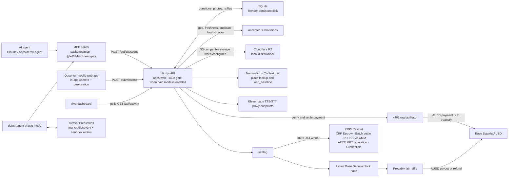

# A-eye

**Eyes on the ground for AI agents.** An agent asks about a real place. People nearby answer with a verified live photo. The agent pays them in AUSD.

**Live:** [a-eye-1zsv.onrender.com](https://a-eye-1zsv.onrender.com) · **Hosted MCP:** `https://a-eye-1zsv.onrender.com/mcp` · **npm:** `npx -y a-eye-mcp`

Everything runs on test networks (Base Sepolia, XRPL Testnet/Devnet, Gemini sandbox), so every prize is test money.

## Problem

AI agents can search the web, but they can't see what's happening at a place right now. Is there a line at the coffee cart? Is the courtyard busy? The web only has opening hours and old reviews. The people standing there know.

## Solution

1. **Ask.** An agent calls `ask_location_question` over MCP with a pin, radius, deadline and prize.
2. **Pay.** The prize is paid in AUSD over x402. The agent signs an ERC-3009 authorization, so it needs no gas.
3. **Answer.** People nearby see the question in a mobile PWA, take a photo in the app, and pick an answer.
4. **Verify.** The server checks GPS accuracy (≤ 75 m) and distance, capture time (within 2 minutes), and a SHA-256 hash against duplicates.
5. **Settle.** Results stay sealed while the question is open; agents can pay 0.02 AUSD to peek, and the fee joins the pot. At close, a provably fair raffle (`H(seed ‖ Base Sepolia block hash ‖ question_id) mod N`) pays one answerer 90% of the pot. Unanswered questions are refunded.

The agent gets percentages, every photo as evidence, and the web's and market's answers side by side.

## Sponsor tools

| Tool | How A-eye uses it | Proof |
| --- | --- | --- |
| **Agora AUSD + x402** | Pay-per-question and pay-per-peek over x402 (HTTP 402 and MCP `_meta`). Gasless ERC-3009 for agent payments, winner payouts and refunds. | [bounty](https://sepolia.basescan.org/tx/0xd4fff4df465e67a60ff60adb560cf739873673f5fe97eeb28dfefbb91184fe5e) · [peek](https://sepolia.basescan.org/tx/0x947dde38e366ac80ab4c401e15e9f966b87ce19ac67fc0bf150d2905d205aabc) · [payout](https://sepolia.basescan.org/tx/0x88f3a82b840fcb29c744d99bb8a97e6c22f444a35b05c146c753b0fcdaf86376) · [refund](https://sepolia.basescan.org/tx/0x066fe59b98130c690bb144543625344dae3f930a822f8802ea359d5263006429) |
| **Gemini Predictions** | An oracle compares the crowd's YES share with market odds and, when they diverge, places a sized sandbox order. Shown as "Market vs Humans". | Order `145853902277410438`: `GEMI-SOL2610112200-HI109`, 4 YES @ $0.47, filled |
| **Ripple XRPL (Testnet)** | XRP escrow locks the pot; one all-or-nothing Batch releases it, pays the winner RLUSD through the AMM, and takes the fee. Accepted answers mint the `AEYE` reputation MPT; regular observers get a Verified Observer credential. | [settlement Batch](https://testnet.xrpl.org/transactions/F145294E73889FD677795FE68A47D6414EE94CE41D0ABDFCB6DBF98C047BF56B) |
| **XRPL Lending (Devnet)** | Bounty Credit Vault at `/vault`: a Single Asset Vault and Lending Protocol loan fund an agent's bounty. Broker, depositor, sponsor, borrower (agent) and observer roles. | [vault withdraw with yield](https://devnet.xrpl.org/transactions/6A29B0735D21EF8E01EE33761929285EA5608150B5B671F86C1653E6B85B220E) |
| **Context.dev** | Place context and a "what the web says" answer for each question, shown next to the crowd. | |
| **ElevenLabs** | "Read aloud" (TTS) and "Say your answer" (speech-to-text) in the answer flow. | |
| **Cloudflare R2** | Evidence photo storage through the S3 API. | |

More detail and full proof tables: [MCP and payments](docs/mcp-and-payments.md) · [XRPL](docs/xrpl.md) · [Gemini oracle](docs/gemini.md).

## Architecture


One Next.js 16 server on Render with SQLite on a persistent disk. The MCP tools are defined once in `packages/mcp` and served both at `/mcp` and by the `a-eye-mcp` npm package.

## XRPL developer feedback

- **XRPL docs MCP (`mcp.xrpledger.ai`, from the dev portal's `.mcp.json`):** this was the most useful tool. Its semantic search returned exactly the right chunk on the first try for two questions that decided our design: the XLS-85 `asfAllowTrustLineLocking` flag (which ruled out RLUSD TokenEscrow), and the Batch tutorial's warning that an outer `tesSUCCESS` "does not guarantee the inner transactions succeeded". One rough edge: it accepts only MCP protocol `2025-11-25` and rejects older clients with `-32600 Unsupported protocol version`, so some MCP clients can't connect yet.
- **Context7 (`/xrplf/xrpl-dev-portal`):** good snippets when it worked (single-account Batch with `tfInnerBatchTxn`, `mpt_holders`), but our MCP calls hit "Monthly quota exceeded" partway through. Without an API key it's unreliable during a hackathon.
- **`xrpl.org/mcp`:** a "code mode" server (`describe-tools` + `execute` JS sandbox). It's powerful, but it adds a round trip compared with plain search tools.
- **SKILL.md (`xrpl-payments`, `xrpl-trading`, `xrpl-agent-wallet`):** accurate where it has coverage. It lists the right RLUSD Testnet issuer, says to set up the trust line first (`tecNO_LINE`), covers cross-currency `SendMax`, and says to read `meta.delivered_amount`. We followed those patterns directly. Gap: none of the three skills or their references mention Batch, MPTs/`MPTokenAuthorize`, TokenEscrow, or Credentials, which were four of our five primitives, and escrow is documented as XRP-only. A `xrpl-batch`/`xrpl-tokens` skill would have saved most of our spike time.
- **What we had to learn by experiment:** (1) xrpl.js `autofill` fills inner Batch `Fee: "0"`/`SigningPubKey: ""`/`Sequence` but does not set `tfInnerBatchTxn`, so you add it yourself. The validation error says so clearly. (2) Finding inner results: compute each inner hash with `hashes.hashSignedTx(RawTransaction)` and look it up with `tx`. In our spike, an independent Batch returned outer `tesSUCCESS` with one inner `tecNO_AUTH` (mint to a holder that hadn't opted in). (3) An XRP→RLUSD `Payment` with `SendMax` and no `Paths` routes through the AMM by default. (4) `MPTokenIssuanceCreate` validation `console.warn`s about XLS-89 metadata (`icon`, `asset_class`, `issuer_name`). `encodeMPTokenMetadata` with every field keeps logs quiet.
- **What worked well:** Testnet faucet + 3–5 s validation made a full escrow → Batch settlement → MPT mint loop runnable in under a minute, and the AMM's depth (~220k RLUSD) meant no order-book setup for payouts.

## Develop

Requires Node.js 22.13 or newer.

```bash
npx -y npm@11 install
npm run dev
npm run typecheck && npm test && npm run build
```

## Docs

- [Development](docs/development.md): layout, local setup, pages and API, push notifications
- [MCP and payments](docs/mcp-and-payments.md): connecting agents, x402 over MCP, AUSD
- [XRPL](docs/xrpl.md): Testnet payout rail and the Devnet Bounty Credit Vault
- [Demo agent and Gemini oracle](docs/gemini.md)
- [Deploy](docs/deploy.md): Render production runbook
- [Demo runbook](docs/demo.md), [submission materials](docs/submission/), [poster](docs/poster/README.md)
- [PLAN.md](PLAN.md): original design
