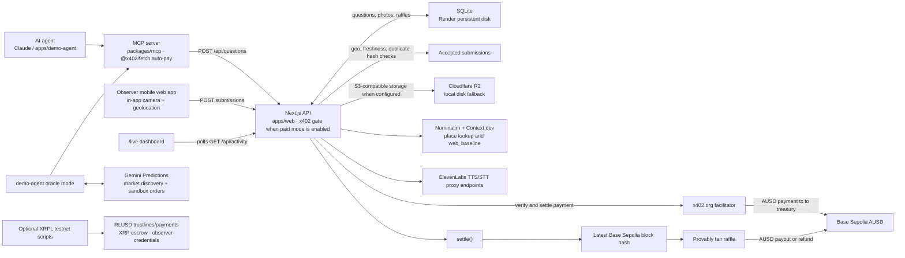

# A-eye

A-eye lets an AI agent ask a question about a real place. Nearby people answer with a fresh, geolocated photo; the agent receives the tally, evidence gallery, and a verifiable raffle result. See [PLAN.md](PLAN.md) for the project plan.

## Layout

- `apps/web`: Next.js 16 app, HTTP API, observer experience, and live dashboard.
- `packages/mcp`: stdio MCP server used by agents.
- `packages/shared`: shared request schemas and API types.
- `apps/demo-agent`: standalone ask and Gemini Predictions oracle demos.
- `apps/web/lib/store.ts`: SQLite schema, question/submission operations, settlement, and raffle.
- `scripts/xrpl-*.ts` and `apps/web/lib/xrpl.ts`: optional, standalone XRPL testnet demos.

## Develop

Requires Node.js 22.13 or newer for the built-in `node:sqlite`.

```bash
npx -y npm@11 install
npm run dev
npm run typecheck && npm test && npm run build
```

The web app is available at `http://localhost:3000`. SQLite defaults to `apps/web/.data/a-eye.db`; photos use `apps/web/.data/uploads` unless an S3-compatible store is configured. Reset the local database and its demo seed with `npm run db:reset -w @a-eye/web`.

Camera and geolocation require HTTPS on a phone. Use an HTTPS tunnel or the hosted demo. For local S3-compatible storage, MinIO can be started with Docker; set `S3_BUCKET`, `S3_ENDPOINT`, and the matching AWS-compatible credentials before running the app.

## Pages and API

- `/`: nearby open questions.
- `/q/[id]/answer`: answer a question with the in-app camera and location check.
- `/q/[id]`: results, evidence gallery, comparisons, and raffle details.
- `/live`: live event feed and dashboard; polls `GET /api/activity?since=&limit=`.
- `/agents`: agent setup information and a test-question form.
- `/me`: observer identity, payout wallet, entries, winnings, stats and badges.
- `/leaderboard`: observer rankings for the week or all time.
- `GET /api/questions`: open questions; `POST /api/questions`: create a question.
- `POST /api/questions/[id]/submissions`: submit a photo answer.
- `GET /api/questions/[id]`: question results.
- `GET /api/activity?since=<ISO>&limit=<n>`: counters, open questions, and recent activity events.

The activity feed settles questions whose deadline has passed when polled. Questions also close immediately when they reach `max_responses`.

## MCP

Build and inspect the stdio server:

```bash
npm run build -w @a-eye/mcp
npx @modelcontextprotocol/inspector node packages/mcp/dist/index.js
```

Claude Desktop / Claude Code config:

```json
{
  "mcpServers": {
    "a-eye": {
      "command": "node",
      "args": ["/path/to/A-eye/packages/mcp/dist/index.js"],
      "env": { "A_EYE_API_URL": "https://a-eye-1zsv.onrender.com" }
    }
  }
}
```

Tools include `ask_location_question`, `get_question_results` (with photos as image blocks), `wait_for_results`, `check_coverage`, and `list_my_questions`. Each evidence item carries `observer_reputation` — the observer's agreement rate with the crowd on past closed questions plus their answer count — so agents can weight answers.

### Payments: x402 and AUSD on Base Sepolia

When a treasury is configured and unpaid mode is disabled, `POST /api/questions` uses [x402](https://x402.org) v2. It requests an exact payment in AUSD on `eip155:84532`, with the amount derived from `prize_usd`. The x402 facilitator verifies and settles the payment to the treasury; the question records the payer and payment transaction. At settlement, the treasury pays the raffle winner the prize less the 10% fee, or refunds a paid question that expires without enough answers. `ALLOW_UNPAID_QUESTIONS=1` bypasses the payment challenge.

Optional `webhook_url` on `POST /api/questions` receives one POST of the final results JSON when the question settles or expires. Destinations must resolve only to public HTTP(S) addresses. `A_EYE_SETTLE_SWEEP_MS` sets the background expiry sweep interval in milliseconds (default `30000`; set to `0` to disable), and `A_EYE_PUBLIC_URL` supplies the public origin used for result links when no request origin was stored.

The MCP server can pay automatically when `AGENT_PRIVATE_KEY` or `A_EYE_AGENT_PRIVATE_KEY` is set. It signs an ERC-3009 authorization, retries the request with the x402 payment header, and returns the facilitator transaction as `payment_tx`. `A_EYE_MAX_PAYMENT_USD` caps an agent payment (default 25). Without a wallet, a paid question request fails with a payment error.

```json
"env": {
  "A_EYE_API_URL": "https://a-eye-1zsv.onrender.com",
  "AGENT_PRIVATE_KEY": "0x..."
}
```

For testnet wallet funding and balances, run `npx tsx scripts/fund-wallets.mts`. A live x402 integration test is available with `X402_E2E=1` in `apps/web/lib/x402.e2e.test.ts`; it requires funded test wallets and treasury configuration.

## Bounty Credit Vault (XRPL Lending, Devnet)

The `/vault` page demonstrates an XRP credit pool that funds an AI agent's human-observer bounty. The agent borrows from an A-eye loan broker, escrows a bounty pot for the observer, repays the loan with interest, and the depositor redeems vault shares with yield at maturity.

| Role | Vault flow |
| --- | --- |
| A-eye broker | Creates the closed-ended vault, sets loan-broker terms, and provides cover. |
| Sponsor / depositor | Deposits XRP during the subscription phase and withdraws shares at maturity. |
| AI agent / borrower | Co-signs the loan, funds the bounty escrow, and repays principal plus interest and fees. |
| Human observer | Receives the escrowed XRP bounty when the escrow is finishable. |

Run the end-to-end Devnet flow with:

```bash
npm run xrpl:vault
```

The script funds fresh broker, depositor, borrower, and observer wallets, then saves their seeds to the ignored `.env.xrpl.local` file with mode `0600`. Keep that local file private; it is not part of the snapshot or commit. The script creates the vault, configures the broker and cover, deposits the sponsor's XRP, waits for the subscription period to end, opens a counterparty-signed loan, escrows and releases the observer bounty, repays and deletes the loan, and withdraws the depositor's vault shares after redemption. It records the run at `apps/web/data/xrpl-vault-run.json` and prints a Devnet explorer link for every submitted transaction. Set `XRPL_LENDING_WSS` to override the Devnet WebSocket endpoint.

1. Create a closed-ended XRP vault and configure A-eye's loan broker and cover.
2. Deposit 40 XRP during subscription and wait for the investment phase.
3. Counter-sign a 20 XRP loan, escrow 5 XRP for the observer, then release that bounty.
4. Repay the loan and close it; after redemption, withdraw the depositor's shares and yield.

The flow requires `SingleAssetVault`, `LendingProtocol`, and `LendingProtocolV1_1`; the recipe is Devnet-only because these amendments are not enabled on XRPL Testnet. The vault must be closed-ended: an open vault does not permit the required loan-broker configuration. If the node is unreachable or any required amendment is disabled, the script prints the planned steps as a dry run and exits successfully without creating wallets or writing a snapshot.

The `/vault` page resolves data in this order: live validated-ledger data (four-second timeout), the committed run snapshot if live reads fail, then a simulated plan when the snapshot is invalid or absent. Set `XRPL_VAULT_LIVE=0` to force the recorded snapshot.

Latest committed Devnet run: the depositor withdrew **40,000,070 drops** from a **40,000,000-drop** deposit, for **70 drops of yield**; share price moved from `1` to `1.00000175` drops per share.

| Step | Devnet transaction |
| --- | --- |
| Vault create | [F360FFED](https://devnet.xrpl.org/transactions/F360FFEDC9FA77F7C242430523FB858475DA90596AE07252A20A9DF0B9C34B48) |
| Loan broker set | [D5552253](https://devnet.xrpl.org/transactions/D5552253A1959C888188A86272960EBF1E4FAEC71AE9B45D5B027B6DE06BB775) |
| Cover deposit | [6567E85E](https://devnet.xrpl.org/transactions/6567E85E510D4E9D6DD2D92936BEC7DCAC61171D1E26423BC65BBB52B3E8196D) |
| Vault deposit | [BAF7F785](https://devnet.xrpl.org/transactions/BAF7F785371BCDCAC19BC1346F66F8C55473F1BBC378E5507D2F66AB3AA1345F) |
| Counterparty-signed loan set | [E6E44755](https://devnet.xrpl.org/transactions/E6E447554AB9B11A6641F688A1E165CB473AF0FBF692D48312BCD29CB6445C0D) |
| Bounty escrow | [ED9B569E](https://devnet.xrpl.org/transactions/ED9B569E917C1AC616D2CD2DB91C12729E980081270AF28128AE41A3702D04AA) |
| Bounty paid to observer | [1FD63195](https://devnet.xrpl.org/transactions/1FD6319532E77B88891AD2B95FFC9D13091D24CAC7A55A9A17EB5857D49AC97B) |
| Loan repayment | [C530E8A6](https://devnet.xrpl.org/transactions/C530E8A66AB97B4A3492DB41B2D8E81900CE519C3ED84CE699C44F81F72F36D3) |
| Loan delete | [EA62181A](https://devnet.xrpl.org/transactions/EA62181A4D48F3205AA5845EF45FC02AFF99F3411969BA1A9D8C19E44BBB0878) |
| Vault withdraw | [A7D87BF4](https://devnet.xrpl.org/transactions/A7D87BF4BD93E39661BB78D38A29102507AAB45CADBFFCFA4A57AB907C14BBDC) |

## Demo agent

The demo agent uses the A-eye MCP server for questions and results. Its LLM needs `OPENAI_API_KEY` or `DEEPSEEK_API_KEY`; set `A_EYE_API_URL` to choose the server. Examples:

```bash
npm run ask -w @a-eye/demo-agent -- "Is there a line at the coffee cart outside Chou Hall?" --minutes 10
npm run oracle -w @a-eye/demo-agent -- --minutes 10 --dry-run
```

Oracle discovery reads Gemini sandbox and production markets, but order placement is hard-coded to the sandbox. Remove `--dry-run` only when Gemini sandbox credentials are configured and a sandbox order is intended. `npm run oracle -w @a-eye/demo-agent -- --list` lists observable contracts.

### Push notifications

Observers can opt in to "new question near you" web push (installable PWA + `/sw.js`). Generate VAPID keys once with `npm run vapid:keys` and set `VAPID_PUBLIC_KEY` / `VAPID_PRIVATE_KEY` / `VAPID_SUBJECT` on Render — with none set, push is a silent no-op. Subscriptions are stored server-side with a coarse (~110 m) location, and one subscription hears about at most one question every 3 minutes (`PUSH_MIN_INTERVAL_SECONDS`).

## Deploy

The Render service is [`https://a-eye-1zsv.onrender.com`](https://a-eye-1zsv.onrender.com) (configuration in `render.yaml`). It runs as one Node server and mounts a persistent disk at `/var/data` for SQLite and local uploads. Render currently sets `ALLOW_UNPAID_QUESTIONS=1`; configure a treasury and disable that flag to demonstrate x402 payments. Configure the `S3_*` environment variables to store photos in Cloudflare R2 instead of on the Render disk.

## Architecture



The Gemini oracle attaches `market_ref` (provider, contract, `implied_yes`) to the question it asks; it is stored with the question and the gallery shows it as "Market: X% · Humans: Y%". The answer flow reads questions aloud and accepts spoken answers through the ElevenLabs TTS/STT proxy routes. XRPL helpers are a separate testnet demo, not part of the AUSD question-settlement path: RLUSD payments require a destination trustline, the escrow pot is XRP, and credential issuance/acceptance are separate operations.

## 3-minute demo runbook

**Before the clock:** For a paid demo, fund the Base Sepolia agent and treasury wallets, configure the agent's AUSD wallet and server treasury, and turn off Render's `ALLOW_UNPAID_QUESTIONS=1`. Open [`/live`](https://a-eye-1zsv.onrender.com/live) on the projector and have judges scan its QR code. If payment setup is unavailable, leave unpaid mode on and explain that no payment transaction or payout is expected.

| Time | Demo step | Fallback |
| --- | --- | --- |
| 0:00–0:30 | Check the projector dashboard and judge phones. Confirm the question agent has its LLM key and can reach the configured MCP server. | If the agent cannot run, post a test question from `/agents`; if phones cannot scan the QR, share the question or answer URL directly. |
| 0:30–1:00 | Ask the live question with the documented command: `npm run ask -w @a-eye/demo-agent -- "Is there a line at the coffee cart outside Chou Hall?" --minutes 10`. Watch the question and, in paid mode, its payment transaction appear on `/live`. | For a shorter rehearsal, use `--minutes 1`. If the agent wallet is unavailable, use the unpaid dev mode. |
| 1:00–1:45 | Judges answer with fresh photos. Show the submissions arriving on `/live` and the evidence gallery at `/q/<id>`. | If camera or location permission fails, use another HTTPS-enabled phone; otherwise use the seeded sample gallery to explain the evidence view. |
| 1:45–2:15 | Let the question reach its response cap or deadline. The activity poll settles a question after its deadline; the gallery shows the tally and any available “Web says / Humans say” or “Market vs Humans” comparison. | If the timer has not elapsed, reach the configured response cap or continue with a settled sample question. The market comparison appears only for questions asked with a `market_ref` (oracle mode). |
| 2:15–2:35 | Reveal the raffle on `/live`; open `/q/<id>` and run the “Verify it yourself” snippet against the revealed seed, block hash, and submission IDs. | If the network entropy RPC is offline, the draw uses the disclosed `offline:<hash>` fallback entropy and remains reproducible. |
| 2:35–2:45 | Show the payout transaction on BaseScan when the question was paid, the winner has an EVM wallet, and the treasury is funded. | With no winner wallet or a failed/unfunded transfer, payout remains pending; use unpaid mode only to demo the raffle, not an on-chain payout. |
| 2:45–3:00 | Run the Gemini oracle: `npm run oracle -w @a-eye/demo-agent -- --minutes 10 --dry-run`. It compares a market with crowd YES answers and reports a sandbox-order decision. | If Gemini has no observable candidate or credentials, run `npm run oracle -w @a-eye/demo-agent -- --list` and describe the sandbox-only order path; keep `--dry-run` for a safe demo. |

The oracle command uses `--dry-run` for safety. Remove that flag only for an intentionally placed Gemini sandbox order.
