# Demo agent and Gemini oracle

## Demo agent

The demo agent uses the A-eye MCP server for questions and results. Its LLM needs `OPENAI_API_KEY` or `DEEPSEEK_API_KEY`; set `A_EYE_API_URL` to choose the server. Examples:

```bash
npm run ask -w @a-eye/demo-agent -- "Is there a line at the coffee cart outside Chou Hall?" --minutes 10
npm run oracle -w @a-eye/demo-agent -- --minutes 10 --dry-run
```

Oracle discovery reads Gemini sandbox and production markets, but order placement is hard-coded to the sandbox. Remove `--dry-run` only when Gemini sandbox credentials are configured and a sandbox order is intended. `npm run oracle -w @a-eye/demo-agent -- --list` lists observable contracts.

## Gemini Prediction Markets oracle

The oracle compares the local crowd's YES forecast with public Gemini prediction-market odds, then sizes any eligible trade and submits it only to Gemini's sandbox. Discovery currently targets Crypto and Commodities contracts.

```mermaid
flowchart LR
  AGENT["demo-agent oracle"] --> ODDS["Gemini public market odds"]
  ODDS --> QUESTION["A-eye question<br/>market_ref"]
  QUESTION --> HUMANS["Nearby human answers"]
  HUMANS --> RESULTS["Question results<br/>crowd YES %"]
  RESULTS --> SIZE["sizeTrade<br/>edge + bounded sizing"]
  SIZE --> ORDER["Gemini sandbox order"]
  ORDER --> CANCEL["Cancel unfilled remainder"]
  CANCEL --> RECORD["POST recorded trade to A-eye"]
  RECORD --> CARDS["/live + gallery<br/>Market vs Humans"]
```



Run against the hosted A-eye service:

```bash
A_EYE_API_URL=https://a-eye-1zsv.onrender.com npm run oracle -w @a-eye/demo-agent -- --minutes 10
```

Useful modes:

```bash
npm run oracle -w @a-eye/demo-agent -- --list
npm run oracle -w @a-eye/demo-agent -- --minutes 10 --dry-run
npm run oracle -w @a-eye/demo-agent -- --question <question-id>
npm run oracle -w @a-eye/demo-agent -- --question <question-id> --dry-run
npm run oracle -w @a-eye/demo-agent -- --positions
npm run oracle -w @a-eye/demo-agent -- --cancel-all
```

Configure `GEMINI_API_KEY` and `GEMINI_API_SECRET` for sandbox trading. Private requests use the sandbox API and the `primary` account by default; set `GEMINI_ACCOUNT` to override it. Set `A_EYE_API_URL` to select the A-eye server, and `A_EYE_TRADE_TOKEN` only when that server requires a bearer token for trade recording. Never put Gemini credentials in logs or source control.

Sizing and exposure controls:

| Control | Default | Maximum / behavior |
| --- | ---: | --- |
| Crowd divergence threshold (`ORACLE_DIVERGENCE_PTS`) | 15 points | Must also meet the minimum-response requirement |
| Minimum responses (`ORACLE_MIN_RESPONSES`) | 3 | No trade below this count |
| Minimum edge (`ORACLE_MIN_EDGE`) | 0.03 | No trade below this probability edge |
| Bankroll / Kelly fraction | $20 / 0.25 | Used to calculate a conservative stake |
| Maximum contracts (`ORACLE_MAX_CONTRACTS`) | 10 | Hard ceiling: 50 contracts |
| Maximum notional (`ORACLE_MAX_NOTIONAL_USD`) | $5 | Hard ceiling: $25 |
| Fixed quantity (`GEMINI_ORDER_QTY`) | unset | Still bounded by both hard ceilings |
| Limit price | — | Rounded to cents and clamped to $0.01–$0.99 |
| Fill wait (`ORACLE_FILL_WAIT_S`) | 10 seconds | Cancel any unfilled remainder afterward |

Other sizing inputs are `ORACLE_BANKROLL_USD` (default `$20`), `ORACLE_PRIOR_WEIGHT` (default `5`), and `ORACLE_KELLY_FRACTION` (default `0.25`). Oracle-generated trades, including dry runs and no-trade decisions, are posted to the question's trade endpoint for the comparison cards.

Sample output excerpt from a real local sandbox run:

```json
{
  "question_id": "b8770c0bb5",
  "candidate": {
    "env": "sandbox",
    "tradable": true,
    "contract_symbol": "GEMI-SOL2610112200-HI109",
    "implied_yes": 0.415,
    "buy_yes": 0.47
  },
  "sizing": {
    "action": "buy_yes",
    "divergence_pts": 58.5,
    "fair_yes": 0.7075,
    "edge": 0.2375,
    "limit_price": "0.47",
    "quantity": "4",
    "notional": 1.88
  },
  "placement": {
    "dry_run": false,
    "order_id": "145853902277410438",
    "status": "filled",
    "filled_quantity": "4",
    "cancelled_remainder": false
  }
}
```
